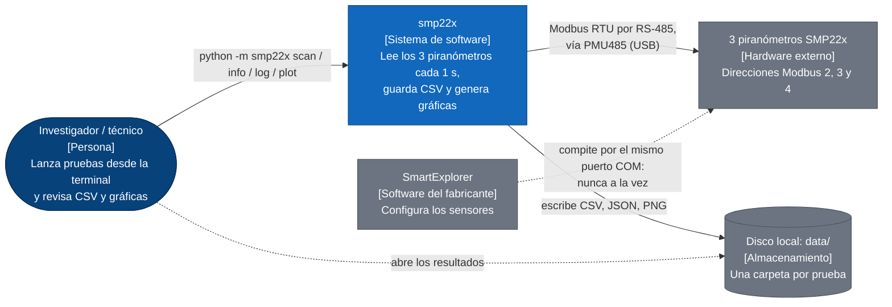
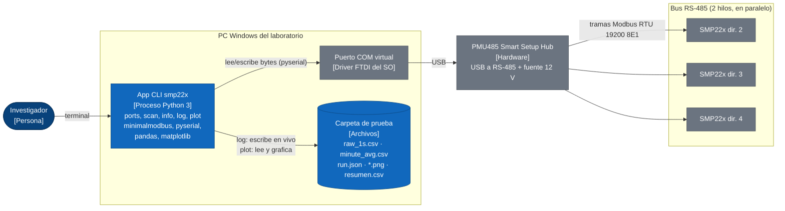
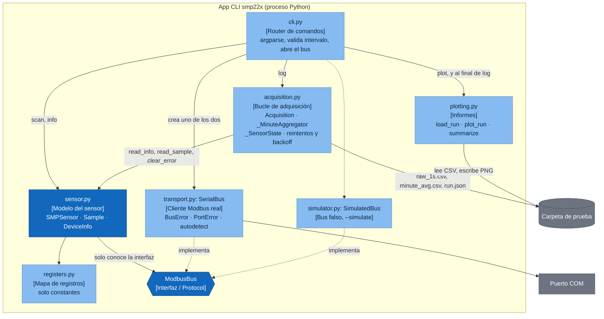
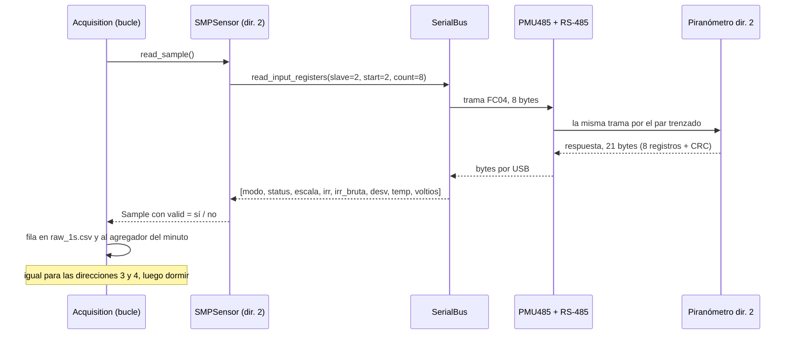

# Cómo funciona el lector de piranómetros SMP22x

Es un programa de terminal en Python que, cada segundo, le pregunta a tres
sensores de radiación solar cuánta luz están recibiendo, guarda las respuestas
en CSV y al final dibuja gráficas. No hay servidor, ni base de datos, ni
interfaz gráfica.

- [Glosario para devs web](#glosario-para-devs-web)
- [C4 nivel 1 · Contexto](#c4-nivel-1--contexto)
- [C4 nivel 2 · Contenedores](#c4-nivel-2--contenedores)
- [C4 nivel 3 · Componentes](#c4-nivel-3--componentes)
- [Un ciclo de 1 s](#un-ciclo-de-1-s)
- [Bugs verificados](#bugs-verificados)

## Glosario para devs web

| Término | Qué es aquí | Equivalente web |
|---|---|---|
| Piranómetro SMP22x | Sensor de Kipp & Zonen que mide radiación solar en W/m². Hay tres, en las direcciones 2, 3 y 4. | Un pequeño servidor que solo expone datos de lectura. |
| RS-485 | El cable físico: dos hilos trenzados compartidos por todos los sensores en paralelo. | La red, pero un bus compartido donde solo habla uno a la vez. |
| Modbus RTU | El protocolo del cable. El PC (maestro) pregunta y el sensor (esclavo) responde. El sensor nunca habla si no le preguntan. | HTTP petición/respuesta. Maestro = cliente, esclavo = servidor. |
| Dirección (slave id) | Número 1–247 de cada sensor. Todos oyen la petición, solo responde el que tiene esa dirección. | El host o la IP de destino. |
| Registro | Casilla de 16 bits en la memoria del sensor. El 5 es la irradiancia, el 8 la temperatura. Mapa completo en `registers.py`. | Un campo de un endpoint: `GET /registers/5`. |
| FC04 / FC05 | "Function code": tipo de operación. FC04 lee varios registros seguidos; FC05 escribe un "coil" (booleano). | El método HTTP. FC04 ≈ GET de un rango, FC05 ≈ POST de un flag. |
| Coil 10 (IO_CLEAR_ERROR) | El único "botón" que el programa pulsa: borra los flags de error que el sensor enciende siempre al arrancar. | Un `POST /errors/clear` idempotente. |
| Half-duplex, un maestro | Solo viaja una trama a la vez, así que los sensores se consultan en serie. | Un servidor con un único worker: nada de `Promise.all`. |
| PMU485 | Caja que convierte USB a RS-485 (chip FTDI) y da 12 V a los sensores. En Windows aparece como `COMx`. | El router/gateway entre el PC y esa red. |
| Baudios, 8E1 | 19200 bits/s, 8 bits de datos, paridad par, 1 bit de parada. Cada byte ocupa 11 bits = 0,573 ms. | El ancho de banda del enlace, fijo y muy bajo. |
| Timeout / CRC | Sin respuesta en 0,3 s la lectura falla. Cada trama lleva un CRC para detectar bytes corruptos. | Timeout de `fetch` y checksum de integridad. |
| Status flags | Registro donde cada bit es un aviso (VOID_DATA, OVERFLOW, ERROR…). Algunos invalidan la medida y otros no. | Una máscara de bits, como `chmod 755`. |
| Scale factor | Registro que dice por cuánto dividir la irradiancia: con 1, el valor 8234 es 823,4 W/m². | Un campo que indica la unidad del resto del payload. |

## C4 nivel 1 · Contexto

Zoom más lejano: el software es una caja negra y solo se ven personas y
sistemas alrededor.



- Es una herramienta de terminal que corre en el portátil conectado por USB a
  los sensores. La "base de datos" son archivos CSV en una carpeta.
- SmartExplorer aparece porque es el único conflicto real: un puerto COM solo
  lo abre un programa y un bus Modbus solo admite un maestro.

## C4 nivel 2 · Contenedores

En web serían "frontend, API, base de datos". Aquí son un proceso Python, un
driver de puerto serie, el bus físico y una carpeta de archivos.



| Contenedor | Qué hace | Equivalente web |
|---|---|---|
| App CLI smp22x | Un solo proceso que vive mientras dura el comando. Con `log` queda en bucle hasta la duración pedida o Ctrl+C. | Un script de Node que corres con `npx`, sin servidor. |
| Carpeta de prueba | Cada `log` crea una carpeta nueva. Se hace `flush` en cada ciclo, así que un corte no pierde lo ya leído. | La base de datos, append-only. |
| Puerto COM + PMU485 | El programa abre `COM10` como si fuera un archivo y escribe bytes. Driver y caja hacen el resto. | El socket TCP y la tarjeta de red. |
| Los 3 sensores | Responden a Modbus. Actualizan la irradiancia una vez por segundo: leer más rápido no aporta nada. | Tres APIs externas con rate limit físico. |

## C4 nivel 3 · Componentes

Zoom dentro del proceso Python. Cada caja es un archivo de `smp22x/`.



| Archivo | Responsabilidad | Si fuera una app web |
|---|---|---|
| `cli.py` | Lee argumentos, elige el comando, abre el bus (real o simulado) y traduce errores de puerto a un mensaje y código de salida 2. | Router + controllers de Express. |
| `acquisition.py` | Corazón de `log`: bucle alineado al segundo, una lectura por sensor, CSV, promedios por minuto y estadísticas. | Un worker/cron que hace polling y escribe en la BD. |
| `sensor.py` | Sabe qué registros pedir y cómo pasar enteros crudos a W/m², °C y V. Decide si una muestra es válida. | Capa de servicio + DTO (`Sample`). |
| `registers.py` | Copia en código del apéndice 15 del manual. | El archivo OpenAPI / tipos de la API externa. |
| `transport.py` | Envía y recibe tramas. Convierte errores de librería en `BusError` (un sensor no contestó) y `PortError` (se perdió el USB). | Cliente HTTP (axios) con interceptores de error. |
| `simulator.py` | Misma interfaz que el bus real, con tres sensores falsos, retrasos realistas y timeouts aleatorios. | Un mock server tipo MSW. |
| `plotting.py` | Carga una prueba con pandas, dibuja `irradiancia.png` y `comunicacion.png`, calcula el resumen. | La página de reportes. |

> **Idea de diseño clave:** `sensor.py` nunca toca el puerto serie; recibe
> cualquier objeto que cumpla `ModbusBus`. Así `--simulate` y los tests cambian
> el bus real por uno falso sin tocar el resto. Es inyección de dependencias,
> como pasar un cliente HTTP mockeado a un servicio.

## Un ciclo de 1 s

Por sensor, una sola petición FC04 de 8 registros (del 2 al 9). Se repite para
las direcciones 3 y 4 y el programa duerme hasta el siguiente segundo exacto.



| Situación | Qué hace el código | Dónde |
|---|---|---|
| Un sensor no contesta | `BusError` → muestra con `ok=False`, se guarda con el error. Tras 5 fallos seguidos solo se le pregunta cada 10 ciclos. | `sensor.py`, `acquisition._account` |
| Se desconecta el USB | `PortError` → se corta el ciclo y se reabre el puerto cada 2 s hasta que vuelva o Ctrl+C. | `acquisition._recover_port` |
| Flags de arranque (ERROR, POWER_FAILED) | No invalidan la medida. Se borran con el coil 10, máximo una vez cada 30 s por sensor. | `acquisition._clear_error` |
| Cambia el minuto | Se cierra el minuto anterior: n.º de muestras, media, mín, máx, desviación. `complete=1` si ≥ 80 % válidas. | `_MinuteAggregator` |
| Cada 60 s | Lee además humedad y presión internas (registros 16–17). | `read_sample(with_diagnostics)` |
| El ciclo pasa de 1 s | Salta al siguiente segundo libre y cuenta un `overrun`. | `acquisition._loop` |

En la [prueba 01](prueba-01.md) cada ciclo de 3 sensores tardó 93 ms de media
(bus ocupado un 9 %).

## Bugs verificados

Reproducidos con un script aparte usando el simulador, sin tocar el código.
Ninguno afecta a la medida de irradiancia.

### 6 · `run.json` calcula el tiempo en cable siempre a 19200 baudios — confirmado, menor

[`acquisition.py:201`](../smp22x/acquisition.py#L201)

```python
wire_ms = read_transaction_wire_time_s(reg.FAST_BLOCK_COUNT, reg.DEFAULT_BAUDRATE) * 1000
```

`AcquisitionConfig` no guarda los baudios y `ModbusBus` no declara `baudrate`
(aunque `SerialBus` y `SimulatedBus` sí lo tienen).

- **Prueba:** bus simulado a 9600 → `theoretical_wire_ms_per_read: 20.6`. Lo
  correcto a 9600 es 41.2 ms.
- `cli.check_interval` sí usa `args.baud`; solo falla el número guardado. La
  prueba 01 fue a 19200, así que su `run.json` es correcto.

### 7 · Una desconexión del USB cuenta también como error de comunicación — confirmado, menor

[`acquisition.py:315-320`](../smp22x/acquisition.py#L315)

```python
st.requests += 1
try:
    sample = sensor.read_sample(with_diagnostics=do_diag)
except PortError as exc:
    self._recover_port(exc)
    break          # st.ok no se incrementa
```

`comm_errors = requests - ok`, así que cada `PortError` suma un error de
comunicación al sensor de turno además de `port_errors`.

- **Prueba:** un `PortError` al leer el sensor 3 → `requests=4 ok=3
  comm_errors=1` y `port_errors=1`. La consola muestra "3/4 respuestas".
- **Relacionado:** ese ciclo se guarda en `cycle_ms` con los ≥ 2 s de
  reconexión dentro, lo que infla `cycle_ms_max`, el p95 y la ocupación del bus.

### 8 · `cmd_scan` sobrescribe `args.baud` y `args.parity` — confirmado, sin efecto hoy

[`cli.py:134`](../smp22x/cli.py#L134) (el reporte decía `:486`, pero `cli.py`
tiene 258 líneas)

```python
for baud, parity in combos:
    args.baud, args.parity = baud, parity
    bus = _open_bus(args)
```

Hoy no rompe nada porque `cmd_scan` termina justo después. Se rompería si algo
reutiliza `args` tras el scan.

- **Prueba:** `scan --simulate --all-baud` → antes `19200 E`, después `115200 O`.
- **Hallazgo de paso:** esa ejecución reporta "15 sensores" buscando en una
  sola dirección: el simulador ignora baudios y paridad, y su descripción
  siempre dice "8E1". Solo afecta al modo simulado.
