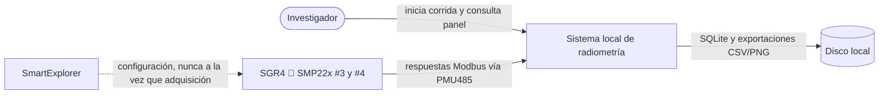
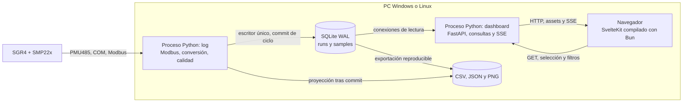
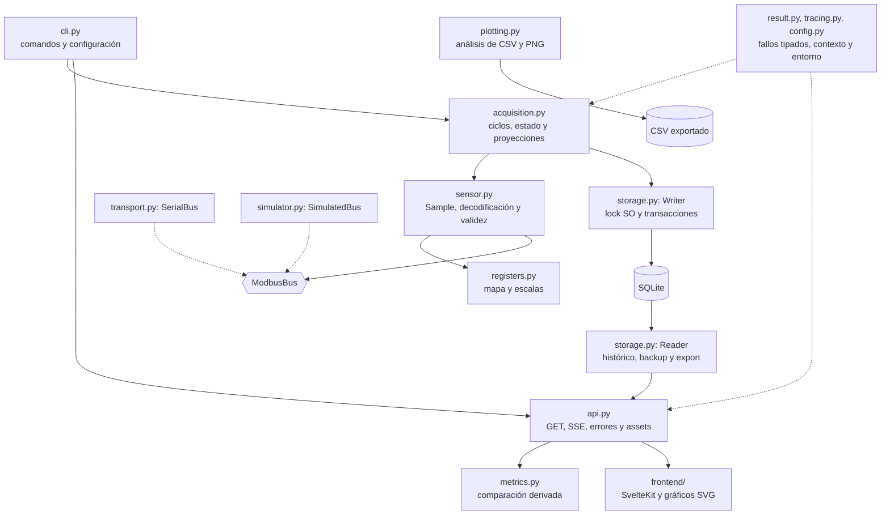

# Arquitectura actual: adquisición y dashboard

Dos procesos Python independientes y un navegador. El primero consulta los
instrumentos; el segundo presenta lo que ya se confirmó en SQLite. Instrucciones
de arranque en [operación](operacion-dashboard.md), conversiones en la
[guía de registros](lectura-registros.md).

## Vocabulario para un desarrollador web

| Concepto | Significado aquí |
|---|---|
| Equipo Modbus | Instrumento con dirección 2, 3 o 4; responde cuando se le consulta |
| Registro | Campo dentro del equipo; dirección PDU base cero, no dirección del instrumento |
| RS-485 / Modbus RTU | Enlace y protocolo del bus; peticiones secuenciales, un único maestro |
| PMU485 / COM | Conversor USB/RS-485 y puerto virtual del sistema operativo |
| Corrida (`run_id`) | Una sesión de adquisición, con configuración y equipos identificados |
| Ciclo (`cycle`) | Grupo de consultas secuenciales; no equivale a simultaneidad |
| Cursor de muestra (`id`) | Orden de inserción confirmado; permite reconectar sin depender del reloj |
| WAL | Modo SQLite que admite lectores mientras escribe la adquisición |
| SSE | Conexión HTTP que lleva novedades desde FastAPI al navegador |
| Build estático | Archivos de SvelteKit que FastAPI sirve; no hay proceso Bun en producción |

## C4 nivel 1: contexto



La dirección 2 es pirgeómetro, no piranómetro. Se conservan neta y Ld↓; no se
promedian junto con la irradiancia de onda corta de #3 y #4. La compatibilidad
del perfil SGR4 antiguo sigue pendiente de confirmación de laboratorio.

## C4 nivel 2: contenedores y procesos



FastAPI no abre COM ni inicia adquisición. Al reiniciarlo, `log` sigue escribiendo.
SQLite no es un servicio adicional: es un archivo y una biblioteca embebida.
La web de esta versión es de lectura. Docker dispone dos contenedores con los
mismos procesos; el uso nativo sigue disponible para la mini-PC Windows.

## C4 nivel 3: componentes



| Componente | Responsabilidad |
|---|---|
| `sensor.py` | Interpretar enteros según el perfil; preservar palabras originales; no recalibrar |
| `acquisition.py` | Planificar y secuenciar; confirmar ciclo antes de CSV; detener ante error de almacenamiento |
| `storage.py` | Único escritor con lock de SO; esquema versionado; lectores cortos y backup consistente |
| `api.py` | Validar filtros; mapear errores; servir muestras confirmadas; no entregar tracebacks al navegador |
| `frontend/src/lib/data.ts` | Result de cliente, deduplicación y buffer acotado; datos ausentes no son cero |
| `Chart.svelte` | Gráficas SVG locales sin CDN; interrupciones de línea para inválidos y huecos |
| `tracing.py` | JSON con trace_id, cadena de operaciones, duración y contexto permitido |

## Recorrido de un ciclo

```mermaid
sequenceDiagram
  participant A as Adquisición
  participant S as Sensor/Modbus
  participant W as Escritor SQLite
  participant F as FastAPI
  participant U as SvelteKit
  A->>S: FC04, equipo 2, PDU 2, cantidad 10
  S-->>A: palabras U16
  Note over A: signo, escalas, validez; conservar originales
  A->>S: equipos 3 y 4, PDU 2, cantidad 8
  S-->>A: palabras U16
  A->>W: muestras del ciclo + estado
  W-->>A: commit confirmado o Err
  Note over A: proyecciones CSV después del commit
  F->>W: consulta incremental de solo lectura
  W-->>F: muestras confirmadas con ID
  F-->>U: SSE con cursor
  Note over U: deduplicar, limitar ventana y actualizar calidad
```

No se requiere que web esté activa cuando se confirma el ciclo. Al reconectar,
la UI recupera IDs posteriores al cursor. Los tiempos de cada lectura son del PC
y difieren dentro del ciclo. Las derivadas y limitaciones científicas están en
[tratamiento de datos](tratamiento-datos.md).

## Comportamiento ante fallos

| Fallo | Comportamiento |
|---|---|
| Sensor sin respuesta | Muestra fallida con error explícito; backoff tras cinco fallos |
| USB desconectado | Reintentos; estadísticas separadas de fallos de sensor |
| Escritura SQLite fallida | Err tipado y corrida detenida con error; no comunicar datos como confirmados |
| Dos adquisiciones para la misma BD | La segunda falla con `writer_active` |
| Proceso muerto abruptamente | Locks del SO liberados; commits completos recuperables; siguiente escritor marca corrida interrumpida |
| API/navegador cerrado | Adquisición continúa; GET/SSE recuperan por cursor |
| Mapa/escala desconocidos | Advertencia o muestra inválida según caso; no inventar una conversión |

Los bugs previos de baudios, desconexión contada como fallo de sensor y mutación
de argumentos de scan conservan tests de regresión. Evidencias actuales en
[SDD/tasks](sdd/tasks.md).
