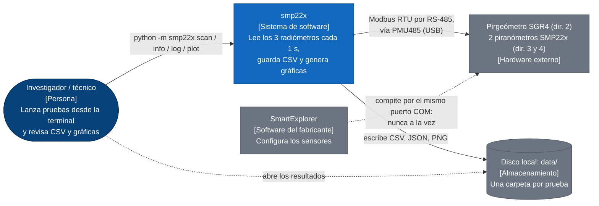
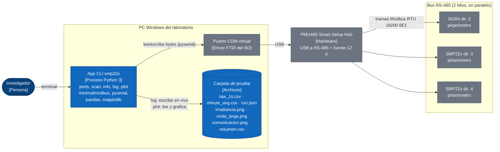
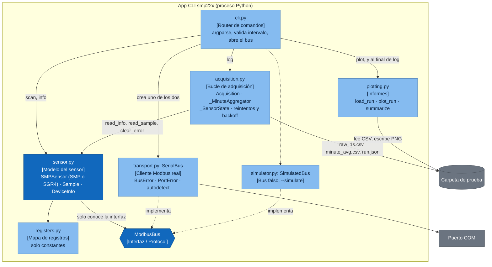
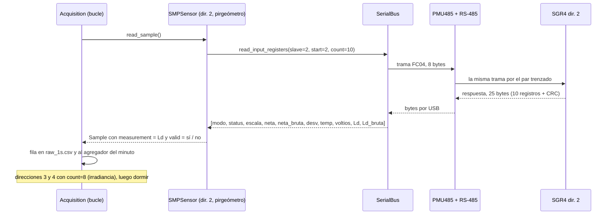

# Cómo funciona el lector de radiómetros SMP22x + SGR4

**Arquitectura implementada actualmente:** CLI y CSV. El diseño futuro con
SQLite, FastAPI y SvelteKit está separado en el [plan del dashboard](plan-dashboard.md).
Para direcciones, conversiones y páginas de los manuales, consultar la
[guía de registros](lectura-registros.md).

Es un programa de terminal en Python que, cada segundo, le pregunta a tres
sensores de radiación cuánta energía están recibiendo, guarda las respuestas en
CSV y al final dibuja gráficas. Dos son piranómetros (luz solar) y uno es un
pirgeómetro (infrarrojo del cielo). No hay servidor, ni base de datos, ni
interfaz gráfica.

- [Glosario para devs web](#glosario-para-devs-web)
- [C4 nivel 1 · Contexto](#c4-nivel-1--contexto)
- [C4 nivel 2 · Contenedores](#c4-nivel-2--contenedores)
- [C4 nivel 3 · Componentes](#c4-nivel-3--componentes)
- [Un ciclo de 1 s](#un-ciclo-de-1-s)
- [Bugs corregidos](#bugs-corregidos)

## Glosario para devs web

| Término | Qué es aquí | Equivalente web |
|---|---|---|
| Piranómetro SMP22x | Sensor de Kipp & Zonen que mide radiación solar (onda corta) en W/m². Hay dos, en las direcciones 3 y 4. | Un pequeño servidor que solo expone datos de lectura. |
| Pirgeómetro SGR4 | Sensor que mide la radiación infrarroja (onda larga) que emite el cielo, Ld↓, en W/m². Está en la dirección 2. Habla el mismo Modbus que los SMP, pero dos registros significan otra cosa. | Otro servidor con la misma API, pero algunos campos con otro significado. |
| Radiación neta / Ld↓ | El SGR4 mide la diferencia entre lo que recibe del cielo y lo que él mismo emite (neta, casi siempre negativa). Ld↓ = neta + σT⁴, con T la temperatura del sensor. | Un campo derivado que el servidor ya calcula, y que puedes recalcular para validar. |
| RS-485 | El cable físico: dos hilos trenzados compartidos por todos los sensores en paralelo. | La red, pero un bus compartido donde solo habla uno a la vez. |
| Modbus RTU | El protocolo del cable. El PC (maestro) pregunta y el sensor (esclavo) responde. El sensor nunca habla si no le preguntan. | HTTP petición/respuesta. Maestro = cliente, esclavo = servidor. |
| Dirección (slave id) | Número 1–247 de cada sensor. Todos oyen la petición, solo responde el que tiene esa dirección. | El host o la IP de destino. |
| Registro | Casilla de 16 bits en la memoria del sensor. El 5 es la irradiancia (la neta en el SGR4), el 8 la temperatura, el 10 Ld↓ (solo SGR4). Mapa completo en `registers.py`. | Un campo de un endpoint: `GET /registers/5`. |
| FC04 / FC05 | "Function code": tipo de operación. FC04 lee varios registros seguidos; FC05 escribe un "coil" (booleano). | El método HTTP. FC04 ≈ GET de un rango, FC05 ≈ POST de un flag. |
| Coil 10 (IO_CLEAR_ERROR) | El único "botón" que el programa pulsa: borra los flags de error que el sensor enciende siempre al arrancar. | Un `POST /errors/clear` idempotente. |
| Half-duplex, un maestro | Solo viaja una trama a la vez, así que los sensores se consultan en serie. | Un servidor con un único worker: nada de `Promise.all`. |
| PMU485 | Caja que convierte USB a RS-485 (chip FTDI) y da 12 V a los sensores. En Windows aparece como `COMx`. | El router/gateway entre el PC y esa red. |
| Baudios, 8E1 | 19200 bits/s, 8 bits de datos, paridad par, 1 bit de parada. Cada byte ocupa 11 bits = 0,573 ms. | El ancho de banda del enlace, fijo y muy bajo. |
| Timeout / CRC | Sin respuesta en 0,3 s la lectura falla. Cada trama lleva un CRC para detectar bytes corruptos. | Timeout de `fetch` y checksum de integridad. |
| Status flags | Registro donde cada bit es un aviso (VOID_DATA, OVERFLOW, ERROR…). Algunos invalidan la medida y otros no. | Una máscara de bits, como `chmod 755`. |
| Scale factor | Registro que dice por cuánto dividir la irradiancia: con 1, el valor 8234 es 823,4 W/m². | Un campo que indica la unidad del resto del payload. |

## C4 nivel 1 · Contexto

Zoom más lejano: el software es una caja negra y solo se ven personas y
sistemas alrededor.

- Es una herramienta de terminal que corre en el portátil conectado por USB a
  los sensores. La "base de datos" son archivos CSV en una carpeta.
- SmartExplorer aparece porque es el único conflicto real: un puerto COM solo
  lo abre un programa y un bus Modbus solo admite un maestro.

## C4 nivel 2 · Contenedores

En web serían "frontend, API, base de datos". Aquí son un proceso Python, un
driver de puerto serie, el bus físico y una carpeta de archivos.

| Contenedor | Qué hace | Equivalente web |
|---|---|---|
| App CLI smp22x | Un solo proceso que vive mientras dura el comando. Con `log` queda en bucle hasta la duración pedida o Ctrl+C. | Un script de Node que corres con `npx`, sin servidor. |
| Carpeta de prueba | Cada `log` crea una carpeta nueva y hace `flush` por ciclo. Reduce datos pendientes en memoria, pero no garantiza persistencia ante pérdida de energía. | Almacenamiento de filas en archivos. |
| Puerto COM + PMU485 | El programa abre `COM10` como si fuera un archivo y escribe bytes. Driver y caja hacen el resto. | El socket TCP y la tarjeta de red. |
| Los 3 sensores | Responden a consultas secuenciales. La actualización de registro, el intervalo de lectura y el tiempo de respuesta físico son conceptos distintos. SGR §13.1 p. 29 indica respuesta 63 % <6 s. | Tres APIs externas consultadas por un worker. |

## C4 nivel 3 · Componentes

Zoom dentro del proceso Python. Cada caja es un archivo de `smp22x/`.

| Archivo | Responsabilidad | Si fuera una app web |
|---|---|---|
| `cli.py` | Lee argumentos, elige el comando, decide qué dirección es pirgeómetro (`--pyrgeometers`), abre el bus (real o simulado) y traduce errores de puerto a un mensaje y código de salida 2. | Router + controllers de Express. |
| `acquisition.py` | Corazón de `log`: bucle alineado al segundo, una lectura por sensor, CSV, promedios por minuto y estadísticas. | Un worker/cron que hace polling y escribe en la BD. |
| `sensor.py` | Sabe qué registros pedir según el tipo de sensor (2–9 o 2–11) y cómo pasar enteros crudos a W/m², °C y V. Decide si una muestra es válida y cuál es su magnitud principal (`Sample.measurement`). | Capa de servicio + DTO (`Sample`). |
| `registers.py` | Copia en código del apéndice 15 del manual V20, incluidos los registros "only for SGR". | El archivo OpenAPI / tipos de la API externa. |
| `transport.py` | Envía y recibe tramas. Convierte errores de librería en `BusError` (un sensor no contestó) y `PortError` (se perdió el USB). | Cliente HTTP (axios) con interceptores de error. |
| `simulator.py` | Misma interfaz que el bus real: un SGR4 y dos SMP22x falsos, retrasos realistas, timeouts aleatorios y solo responden a 19200 8E1. | Un mock server tipo MSW. |
| `plotting.py` | Carga una prueba con pandas, dibuja `irradiancia.png` (piranómetros), `onda_larga.png` (pirgeómetro) y `comunicacion.png`, calcula el resumen. | La página de reportes. |

> **Idea de diseño clave:** `sensor.py` nunca toca el puerto serie; recibe
> cualquier objeto que cumpla `ModbusBus`. Así `--simulate` y los tests cambian
> el bus real por uno falso sin tocar el resto. Es inyección de dependencias,
> como pasar un cliente HTTP mockeado a un servicio.

## Un ciclo de 1 s

Por sensor, una sola petición FC04: 10 registros (del 2 al 11) para el
pirgeómetro de la dirección 2 y 8 registros (del 2 al 9) para los piranómetros
de las direcciones 3 y 4. Después el programa duerme hasta el siguiente segundo
exacto.

| Situación | Qué hace el código | Dónde |
|---|---|---|
| Un sensor no contesta | `BusError` → muestra con `ok=False`, se guarda con el error. Tras 5 fallos seguidos solo se le pregunta cada 10 ciclos. | `sensor.py`, `acquisition._account` |
| Se desconecta el USB | `PortError` → se corta el ciclo y se reabre el puerto cada 2 s hasta que vuelva o Ctrl+C. Cuenta en `port_errors`, no como error del sensor, y el bucle se vuelve a alinear al reloj. | `acquisition._recover_port`, `_loop` |
| Flags de arranque (ERROR, POWER_FAILED) | No invalidan la medida. Se borran con el coil 10, máximo una vez cada 30 s por sensor. | `acquisition._clear_error` |
| Cambia el minuto | Se cierra el minuto anterior: n.º de muestras, media, mín, máx, desviación. `complete=1` si ≥ 80 % válidas. | `_MinuteAggregator` |
| Cada 60 s | Consulta 16–17; no interpretar humedad/presión como fiables sin confirmar el firmware antiguo. | `read_sample(with_diagnostics)` |
| El ciclo pasa de 1 s | Salta al siguiente segundo libre y cuenta un `overrun`. | `acquisition._loop` |

En la [prueba 01](prueba-01.md) cada ciclo de 3 sensores tardó 93 ms de media
(bus ocupado un 9 %).

## Bugs corregidos

Los tres bugs reportados se confirmaron con el simulador y luego se
corrigieron. Ninguno afectaba a la medida. Cada uno tiene un test de regresión
en `tests/test_smp22x.py` (clase `BugRegressionTests`).

| # | Qué pasaba | Qué se cambió |
|---|---|---|
| 6 | `run.json` calculaba el tiempo teórico en cable con `reg.DEFAULT_BAUDRATE`. Con `--baud 9600` guardaba 20,6 ms en vez de 41,2 ms. | `ModbusBus` declara `baudrate` y `parity`. `_write_meta` usa los del bus y el tamaño de bloque de cada sensor: `per_sensor.*.theoretical_wire_ms_per_read` y `bus_timing.theoretical_wire_ms_per_cycle`. |
| 7 | Un `PortError` (USB desconectado) sumaba `requests` sin respuesta: el sensor de turno mostraba un `comm_error` que no era suyo. Además, el ciclo cortado guardaba en `cycle_ms` los ≥ 2 s de reconexión y los ciclos perdidos contaban como `overruns`. | `requests` se incrementa después de leer, así que un `PortError` no cuenta. El ciclo cortado no entra en `cycle_ms`, el bucle se realinea al reloj sin sumar `overruns` y `run.json` añade `port_downtime_s`. |
| 8 | `cmd_scan` sobrescribía `args.baud` y `args.parity` en cada combinación ([`cli.py:134`](../smp22x/cli.py) en la versión anterior; el reporte decía `:486`). | `_open_bus(args, baud=..., parity=...)` recibe la combinación como parámetros y `args` no se toca. |

Otros arreglos hechos en el camino:

- **El simulador ignoraba baudios y paridad.** `scan --simulate --all-baud`
  encontraba "15 sensores" en una sola dirección y la descripción siempre decía
  "8E1". Ahora los sensores simulados solo contestan a 19200 8E1, como los
  reales de fábrica.
- **Tiempo de carácter sin paridad.** Con `--parity N` el programa usa 8N1,
  que son 10 bits por carácter, pero el cálculo usaba siempre 11.
  `transport.bits_per_char` lo tiene en cuenta.
- **Un error de diagnóstico tapaba otro.** Si fallaba la lectura de humedad y
  presión, su mensaje sobrescribía el de un factor de escala no documentado.
  Ahora se concatenan.
- **Una lectura fallida perdía el tipo de sensor.** La `Sample` de un timeout
  salía siempre como piranómetro. Ahora conserva `sensor_type`.
- Errata en el docstring de `acquisition.py` ("largpoo").
