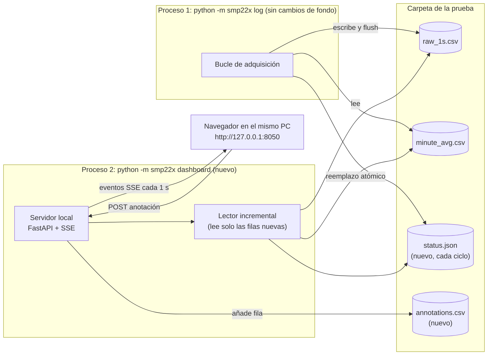

# Plan: dashboard en tiempo real

Propuesta, sin implementar. Describe qué mostraría un dashboard en vivo de las
pruebas, cómo se conectaría al programa actual sin ponerlo en riesgo y en qué
orden construirlo.

## ¿Es posible? ¿Es recomendable?

**Sí a las dos, con una condición: el dashboard sirve para vigilar la prueba,
no para analizarla.** El análisis se sigue haciendo con los CSV guardados, que
son la única fuente de verdad.

Durante una prueba de radiometría, mirar los datos en vivo sirve para darse
cuenta a tiempo de cosas que después no tienen arreglo:

- Un sensor dejó de responder o activó un flag que invalida el dato.
- Los dos piranómetros empiezan a separarse (suciedad, sombra, desnivel, cable).
- La verificación del pirgeómetro (Ld↓ frente a neta + σT⁴) no cuadra.
- Cambian las condiciones (nubes, lámpara, alguien delante del sensor) y hay que
  anotarlo. La [prueba 01](prueba-01.md) ya pedía "anotar las condiciones de
  cada prueba".

Hay dos restricciones técnicas que mandan sobre todo el diseño:

1. **Un solo maestro Modbus.** El dashboard no puede leer el bus RS-485. Si lo
   hiciera, habría dos programas peleando por el puerto COM (D11). Tiene que
   consumir los datos que ya produce el comando `log`.
2. **El dashboard no puede tumbar la adquisición.** Si se cuelga, se cierra el
   navegador o se reinicia el servidor del dashboard, `log` tiene que seguir
   guardando datos sin enterarse.

## Qué mostrar

### Barra de estado (arriba, siempre visible)

| Elemento | Contenido | Por qué |
|---|---|---|
| Prueba | Etiqueta, hora de inicio, duración y tiempo restante, carpeta de datos, `[SIMULADO]` si aplica | Saber qué se está grabando |
| Un chip por sensor | `#2 SGR4`, `#3 SMP22x`, `#4 SMP22x`, coloreado: verde (válido), ámbar (respondió pero inválido o con flags), rojo (sin respuesta) | Ver el estado de un vistazo |
| Última lectura | "hace 1 s"; se pone en rojo si pasan más de 5 s | Detectar que `log` se paró |
| Bus | Ocupación %, ciclos perdidos, timeouts del último minuto, `port_errors` | Salud de la comunicación |

### Tarjetas de valores actuales

| Tarjeta | Fuente | Unidad |
|---|---|---|
| Irradiancia global #3 y #4 | `irradiance_wm2` | W/m² |
| Diferencia #3 − #4 | calculada | W/m² y % |
| Onda larga descendente Ld↓ #2 | `lw_down_wm2` | W/m² |
| Radiación neta #2 | `irradiance_wm2` del SGR4 | W/m² |
| Verificación Ld↓ − (neta + σT⁴) | calculada, como en `info` | W/m², en rojo si pasa de ±5 |
| Minutos completos | `minute_avg.csv`, `complete` | n.º y % del total |

### Gráficas

| # | Gráfica | Ventana | Detalle |
|---|---|---|---|
| 1 | Irradiancia global #3 y #4 a 1 s, con los promedios de 1 min como puntos | Últimos 15 min (ampliable a toda la prueba) | La misma que `irradiancia.png`, pero en vivo |
| 2 | Diferencia relativa #3 vs #4, en % | Últimos 15 min | Es la gráfica clave de una intercomparación. Banda gris en ±2 % como referencia visual |
| 3 | Ld↓ #2 a 1 s y neta + σT⁴ en discontinua | Últimos 15 min | Deben superponerse. Si se separan, el mapa de registros no es el esperado |
| 4 | Temperatura del cuerpo de los 3 sensores | Toda la prueba | Tras encender, la temperatura tarda hasta 3 h en estabilizarse (D13) |
| 5 | RTT por lectura y timeouts | Últimos 15 min | Como `comunicacion.png` |
| 6 | Tensión de alimentación | Toda la prueba | Baja si el PMU485 no da corriente suficiente |

Opcional cuando se conozcan latitud y longitud del sitio: el ángulo cenital del
sol y la irradiancia de cielo despejado esperada (por ejemplo con la librería
`pvlib`). Ayuda a saber si 950 W/m² a las 18:20 es sol o una lámpara.

### Alertas

| Alerta | Condición propuesta |
|---|---|
| Sensor sin respuesta | 5 fallos seguidos (el mismo umbral que el backoff de `acquisition.py`) |
| Muestra inválida | `valid = 0` con el sensor respondiendo |
| Piranómetros separados | \|#3 − #4\| > 2 % durante más de 1 min, con irradiancia > 100 W/m² |
| Verificación del SGR4 | \|Ld↓ − (neta + σT⁴)\| > 5 W/m² |
| Alimentación baja | `supply_v` < 10 V |
| Puerto perdido | `port_errors` sube |
| `log` parado | Sin filas nuevas durante 5 s |

Los umbrales son una propuesta; hay que acordarlos con quien dirige la prueba.

### Anotaciones

Un campo de texto y unos botones rápidos ("limpieza de cúpula", "nube",
"lámpara encendida", "sombra") que guardan `annotations.csv` en la carpeta de la
prueba con la hora. Las gráficas de `plot` pueden dibujarlas después como
líneas verticales. Es la forma más barata de cumplir lo de "anotar las
condiciones".

## Arquitectura propuesta

La idea es que **los archivos que ya escribe `log` sean la interfaz** entre la
adquisición y el dashboard. `log` ya hace `flush` de `raw_1s.csv` en cada
ciclo, así que el dato está en disco con ~1 s de retraso.

Por qué así:

- **Aislamiento total.** Son dos procesos. El dashboard solo lee archivos y no
  toca el puerto COM. Si se cae, `log` ni se entera.
- **El dashboard puede arrancar y parar cuando quiera.** Al arrancar busca la
  carpeta más reciente en `data/` y carga lo que ya hay.
- **Lo que se ve en vivo es exactamente lo que se guarda.** No hay un segundo
  camino de datos que pueda diferir de los CSV.
- **Cambios mínimos en `log`:** solo escribir `status.json` (estado por sensor,
  contadores, último ciclo) con un reemplazo atómico (`os.replace`), para que el
  dashboard no lea un archivo a medio escribir.

Tecnología:

| Pieza | Elección | Alternativa |
|---|---|---|
| Servidor | **FastAPI** con Server-Sent Events. SSE basta porque los datos solo van del servidor al navegador | Streamlit: menos código, pero menos control del refresco y del diseño |
| Gráficas | **uPlot**: muy ligera y pensada para series temporales con miles de puntos | Plotly.js: más pesada, más funciones |
| Frontend | Una página HTML con JS sin build. La librería se guarda en el repo, porque el PC del laboratorio puede no tener internet | — |
| Red | Escucha solo en `127.0.0.1`. Nada sale del PC | — |

Descartado por ahora: **InfluxDB/TimescaleDB + Grafana**. Es el estándar para
una estación de medida permanente, pero para pruebas de 30 min a unas horas
añade una base de datos, un servicio y su mantenimiento sin ganar nada. Tiene
sentido en la fase 2, si esto pasa a medir de forma continua.

## Plan de implementación

| Paso | Qué se hace | Terminado cuando |
|---|---|---|
| 0 | Acordar con quien dirige la prueba qué decide mirando el dashboard, los umbrales de alerta y la ventana de tiempo | Tabla de alertas con valores firmados |
| 1 | `log` escribe `status.json` en cada ciclo con reemplazo atómico | Test que lee `status.json` mientras corre `log --simulate` y nunca encuentra JSON roto |
| 2 | Lector incremental de CSV: guarda la posición del archivo, lee solo las filas nuevas y detecta una carpeta de prueba nueva | Tests con un CSV que crece y con un cambio de carpeta |
| 3 | Lógica de alertas en Python, en un módulo propio, reutilizando `Sample.valid` y `lw_down_calc` | Tests unitarios por alerta |
| 4 | Comando `python -m smp22x dashboard`: FastAPI con `/api/run` (metadatos), `/api/history` (carga inicial), `/api/stream` (SSE) y `/api/annotations` | Responde con `log --simulate` corriendo en otra terminal |
| 5 | Página: barra de estado, tarjetas, 6 gráficas con uPlot, alertas y anotaciones | Se ve bien en el portátil del laboratorio; refresco ≤ 2 s |
| 6 | `plot` dibuja las anotaciones en las PNG | `irradiancia.png` y `onda_larga.png` muestran las líneas |
| 7 | Prueba larga simulada (2 h) y luego una con hardware | Sin crecimiento de memoria ni CPU apreciable; `log` no pierde ciclos |
| 8 | README y decisiones técnicas | Sección "Dashboard" en el README y una decisión D16 |

Dependencias nuevas: `fastapi` y `uvicorn` (servidor) y `uPlot` (archivo JS en
el repo). Esfuerzo estimado: 3 a 5 días de trabajo.

## Fase 2, si pasa a estación permanente

- `log` como servicio de Windows que arranca solo y escribe archivos por día.
- Base de datos de series temporales (InfluxDB o TimescaleDB) y Grafana para
  históricos y alertas por correo.
- Reloj sincronizado por NTP, porque las marcas de tiempo del PC son las del
  dato (el sensor no tiene reloj).
- Conversor RS-485 aislado y fuente de 12 V en lugar del PMU485, que el
  fabricante plantea como herramienta de instalación (README §6).
