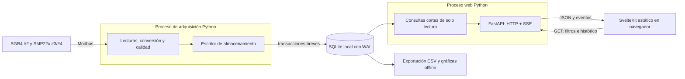

# Plan del dashboard: SQLite + FastAPI + SvelteKit

**Propuesta revisada, sin implementar.** El programa actual escribe CSV y JSON.
Esta revisión sustituye la propuesta de leer CSV en vivo y usar HTML/JS sin
framework. La BD, API y frontend descritos aquí aún no existen en el código.

## 1. Objetivo y responsabilidades

Vigilar pruebas y consultar históricos desde una mini-PC Windows. Se acepta
refrescar cada segundo; objetivo inicial de latencia desde lectura hasta pantalla:
hasta 2 s en funcionamiento normal, a medir en el equipo real. No hay garantía
de plazos propia de un sistema de tiempo real estricto.

- Solo la adquisición abre COM y consulta Modbus, en serie.
- Cerrar o reiniciar el dashboard no debe interrumpir la adquisición.
- El navegador consulta la API. No abre SQLite ni escribe mediciones.
- Primera versión de lectura. Anotaciones y controles quedan para una ampliación.
- Funcionamiento local y sin internet tras instalar paquetes y assets.

**Añadir FastAPI** aporta endpoints de histórico, estado y novedades, validación
y documentación OpenAPI. La lógica científica sigue en módulos Python reutilizables.
Modbus no se inicia en el arranque de FastAPI: reinicios o varios workers web
podrían abrirlo más de una vez. Las llamadas bloqueantes a SQLite se ejecutarán
sin bloquear el bucle de eventos del servidor.

SvelteKit aporta rutas y layouts para vivo e históricos. Se compila mediante
`adapter-static` y consume la API como aplicación cliente. FastAPI sirve el build
y `/api` en el mismo origen. Node se necesita para construir, no como proceso
de producción en la mini-PC. Ese despliegue no admite funciones de servidor de
SvelteKit; las rutas deben funcionar al abrirse directamente. El peso final se
medirá, incluyendo gráficas y assets, sin suponer que toda configuración sea gratis.

## 2. SQLite y concurrencia

Tres muestras por segundo equivalen a unas 259200 filas/día funcionando 24 h.
La capacidad se verificará con el esquema real. SQLite está embebido en Python:
no requiere servicio de BD ni contenedor.

Configuración propuesta: WAL, un escritor de mediciones, conexiones independientes
para lectores, transacciones pequeñas y timeout de bloqueo acotado. El escritor
confirma conjuntamente las muestras obtenidas en cada ciclo, incluidas las fallidas.
Los lectores ven los datos después del commit.

**El intervalo de 1 s es de refresco, no de exclusión mutua.** WAL permite leer
una instantánea mientras se escribe. No se mantiene una transacción abierta
durante toda una conexión SSE o mientras se inspecciona una gráfica. Se limita
cada consulta y se mide duración de commit, retraso de escritura y tamaño del WAL.

La base estará en disco local, fuera de carpetas de red o sincronización activa.
Los backups usarán la API de respaldo de SQLite: copiar solo un `.db` abierto
puede omitir cambios que aún están en el WAL. Se propone `synchronous=FULL`, a
validar midiendo commits en Windows. El `flush` de CSV actual tampoco garantiza
por sí solo persistencia ante pérdida de energía; durabilidad y refresco son distintos.

Se medirá primero una escritura por ciclo. Si afecta al muestreo, un escritor
dedicado podrá consumir una cola **acotada**, indicando por separado datos adquiridos
y confirmados. Ante disco lleno, E/S fallida o bloqueo persistente debe registrarse
el fallo y detener la corrida con error si no puede persistirse. No se descartan
muestras silenciosamente ni se publica éxito sin confirmación.

### Esquema orientativo

| Tabla | Contenido | Claves y reglas |
|---|---|---|
| `runs` | Etiqueta, inicio/fin UTC, configuración, estado, simulación y versión del software | `run_id`; motivo de cierre y detección de corrida interrumpida |
| `run_sensors` | Dirección, tipo configurado, serie, modelo de datos, firmware y perfil de conversión | `(run_id, address)`; la dirección sola no identifica permanentemente al instrumento |
| `samples` | Hora UTC, ciclo, valores físicos, factor, estado, error, RTT y palabras originales | ID creciente; unicidad `(run_id, cycle, address)`; índice `(run_id, address, time_utc)` |
| `minute_aggregates` | Magnitud identificada, media, mínimo/máximo, desviación, recuentos y cobertura | `(run_id, address, minute_utc)`; reconstruible desde muestras |
| `acquisition_status` | Heartbeat del proceso, último ciclo y commit, contadores y desconexiones | Distinguir ausencia de lectura de proceso detenido |

La hora puede almacenarse como entero de microsegundos desde epoch; la API entrega
ISO 8601 con zona UTC. La primera migración fijará esa representación. Se usarán
nombres físicos separados para onda corta, neta de onda larga y Ld↓, evitando
heredar la ambigüedad de `irradiance_wm2` del CSV SGR4.

Se conservarán enteros originales, factor y versión de conversión para permitir
revisiones del mapa (ver [guía de registros](lectura-registros.md)). `NULL` es
ausente; cero es un valor. Los inválidos permanecen con sus motivos, aunque se
excluyan de promedios. El esquema se versionará y los simulados se identificarán.

Para nuevas corridas SQLite será la fuente de verdad y CSV una exportación.
La transición incluye lectura de pruebas antiguas, exportación compatible y
comparación de valores. Escribir BD y CSV por separado no constituye una
transacción atómica conjunta.

## 3. Actualización del navegador

| Mecanismo | Funcionamiento | Uso propuesto |
|---|---|---|
| GET periódico | El navegador pide novedades cada segundo | Primera versión para validar el flujo |
| SSE | HTTP persistente, novedades API → navegador | Evolución prevista para vivo, con reconexión por cursor |
| WebSocket | Canal bidireccional navegador/API | Si aparece una necesidad bidireccional que lo justifique |

FastAPI soporta WebSockets, pero estos no consultan SQLite automáticamente. Tanto
SSE como WebSocket necesitan que el backend consulte filas confirmadas o reciba
notificaciones del escritor. Una consulta incremental cada segundo basta de inicio.
SSE reduce peticiones repetidas del navegador; no garantiza menor latencia que
GET a la misma frecuencia.

Endpoints previstos: `GET /api/runs`, `/api/runs/{id}`, `/api/runs/{id}/samples`,
`/api/runs/{id}/status` y después `/api/runs/{id}/stream`. Histórico con sensor,
intervalo UTC, cursor y límite. El cursor es un ID creciente de inserción, no solo
una hora. Carga inicial y reconexión comparten ese cursor; el frontend deduplica
por ID. Se fija un límite de histórico inicial y se recuperan los IDs posteriores
para cubrir lo insertado durante esa carga.

Un lector de novedades por corrida puede alimentar a varios clientes. Se envían
solo datos confirmados. Ante un cliente lento se corta y resincroniza; no se
acumula memoria sin límite. Las gráficas limitan sus puntos y para históricos
largos piden agregaciones que incluyan mínimo y máximo, evitando ocultar picos.

## 4. Qué verá el investigador

| Vista | Datos | Interpretación |
|---|---|---|
| Estado | Corrida, simulación, última respuesta por sensor, último commit y refresco, fallos del puerto | Separar sensor, almacenamiento y conexión web |
| Tabla actual | #3/#4 onda corta; #2 Ld↓ y neta; unidad, hora, edad, modo, flags y validez | No presentar una lectura antigua como actual |
| Comparación #3/#4 | Diferencia absoluta y relativa, pareja válida del mismo ciclo | `% = 100 × (E3−E4)/((E3+E4)/2)`; ocultar porcentaje cerca de cero |
| SGR4 | Ld↓ leído, neta + σT⁴ y diferencia | Consistencia interna, no calibración independiente |
| Temperatura | Cuerpo de cada sensor | No es temperatura ambiente |
| Comunicación | RTT, fallos por intervalo, desconexiones y retrasos de ciclo | RTT no es respuesta física del detector |
| Alimentación | Tensión del conector | Una caída exige investigar, no identifica una causa por sí sola |
| Calidad | Válidas/esperadas, inválidas, ausencias y cobertura por minuto | `complete=1` actual significa ≥80 % válidas, no cero pérdidas |

Ventana inicial de 15 min, ampliable a histórico. Irradiancia y Ld↓ se muestran
en paneles separados: comparten W/m² pero son magnitudes distintas. No se
rellenan huecos ni se unen visualmente largos periodos sin datos. Humedad/presión
no se presentarán como fiables con perfiles antiguos sin confirmar.

Las comparaciones de un ciclo admiten el desfase de lecturas secuenciales. Si
el objetivo científico exige mayor simultaneidad debe medirse y documentarse
antes de interpretar diferencias durante cambios rápidos.

Alertas propuestas: sensor sin respuesta tras 5 intentos fallidos, dato obsoleto
según edad, desacuerdo sostenido #3/#4, inconsistencia SGR4 y error de persistencia.
Los umbrales anteriores de 2 %, ±5 W/m² y 10 V son propuestas del proyecto,
no límites normativos. En particular SGR §13.1 p. 29 indica alimentación 5–30 V:
10 V no es el límite oficial de funcionamiento. Los umbrales deben justificarse
con el objetivo de la investigación antes de activarlos.

## 5. Implementación por etapas

| Paso | Entregable | Criterio de aceptación |
|---|---|---|
| 0 | Confirmar mapa del firmware real, objetivos y especificaciones de la mini-PC | Perfil de equipos y pendientes explícitos; RAM, CPU, disco y versiones registrados |
| 1 | Interfaz de almacenamiento, migración y escritor SQLite | Recuperar muestras, fallos y enteros originales; transacción por ciclo |
| 2 | Lectores concurrentes, recuperación, backup y exportación | Probar reinicio abrupto, disco lleno y lectura mientras escribe; sin pérdidas silenciosas |
| 3 | API FastAPI de lectura, cursor, heartbeat y consultas acotadas | Histórico y novedades coinciden con BD; reiniciar API no detiene adquisición |
| 4 | SvelteKit estático, estado, tabla y gráficas | Refresco ≤2 s en condiciones normales; memoria acotada; rutas y modo offline correctos |
| 5 | SSE si mejora el comportamiento medido | Reconectar recupera datos sin huecos ni duplicados |
| 6 | Comparaciones y alertas con criterios acordados | Valores bajos, inválidos y ausencias no generan comparaciones engañosas |
| 7 | Prueba sostenida simulada y con hardware en Windows | Medir CPU/RAM, p95 de commit, latencia, disco y ciclos perdidos frente a CLI sin dashboard |
| 8 | Empaquetado e instrucciones Windows y C4 actualizado | Instalación reproducible y análisis de pruebas antiguas conservado |

No se fija un presupuesto CPU/RAM antes de conocer el equipo. Se comprobará
que el dashboard no añade pérdidas de ciclos frente a la adquisición sola.
Las anotaciones futuras llegarían mediante POST a la API como datos de usuario;
entonces se decidirá su almacenamiento y coordinación con el escritor.

## 6. SQLite frente a un servidor de series temporales

SQLite reduce servicios y despliegue. InfluxDB se reconsiderará si crecen equipos,
consultas o necesidades de retención; medir continuamente no obliga por sí solo
a migrar. **InfluxDB 3 Core ofrece binario Windows AMD64**, por lo que Docker no
es obligatorio para esa edición. Deben evaluarse versión, funcionalidades y coste
real de recursos. Docker Desktop para contenedores Linux utiliza virtualización,
habitualmente WSL2, que añade consumo y administración.

Fuentes oficiales de esta propuesta:

- [SQLite WAL](https://sqlite.org/wal.html): concurrencia, un escritor y restricciones de almacenamiento.
- [SQLite Online Backup](https://sqlite.org/backup.html): respaldo consistente de una base abierta.
- [FastAPI WebSockets](https://fastapi.tiangolo.com/advanced/websockets/): canal navegador/API.
- [SvelteKit adapter-static](https://svelte.dev/docs/kit/adapter-static) y [SPA](https://svelte.dev/docs/kit/single-page-apps): build estático y rutas cliente.
- [InfluxDB 3 Core](https://docs.influxdata.com/influxdb3/core/install/): plataformas y binario Windows.
- [Docker Desktop Windows](https://docs.docker.com/desktop/setup/install/windows-install/): virtualización y requisitos.
