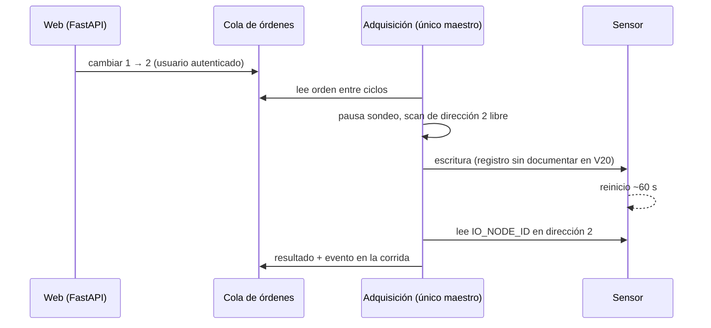

# Propuestas de funcionalidades: validación y orden sugerido

Revisión del 2026-11-06 sobre la rama `dev` (commit `5c1a807`). Evalúa cuatro
ideas no validadas y añade otras surgidas de leer el código, los manuales y las
dos capturas (dashboard Radiometría y monitor SkyVue PRO). Nada de esto está
implementado. Las decisiones tomadas están al final del documento.

> **Estado (2026-11-07):** implementadas como ampliación 2 del SDD (requisitos
> R11–R27). Ver [especificación](sdd/spec.md), [diseño](sdd/design.md) y
> [evidencia](sdd/tasks.md). Quedan fuera, como estaba decidido: cambiar
> direcciones desde la web, pirheliómetro y test de cierre, RS-485 del SOLYS2,
> ceilómetro y autenticación.

## Resumen

| # | Idea | Veredicto | Valor | Costo | Bloqueo o condición |
|---|---|---|---|---|---|
| 0 | Topología de sensores configurable | **Prerrequisito** | Alto | Bajo | Hoy las direcciones 2/3/4 están fijas en UI y métricas |
| 1 | Filtrar por rango y descargar CSV / imágenes | **Sí, primera prioridad** | Alto | Bajo-medio | Decidir volumen y retención antes de rangos largos |
| 2a | Ver dirección, modelo, serie y firmware | **Sí** | Medio | Bajo | Ya se leen; solo falta mostrarlos |
| 2b | Cambiar la dirección del equipo desde la web | **Descartado por ahora** | Bajo (uso raro) | Alto | Decisión del 2026-11-06; además el manual V20 no documenta un registro escribible |
| 3 | Sección de documentación para físicos | **Sí** | Alto | Bajo-medio | Una sola fuente (`docs/*.md`) para que no diverja |
| 4a | Gráficos tipo SkyVue (curtain, perfil) | **Postergado** | Alto cuando exista | Alto | El ceilómetro se integrará más adelante; requiere modelo de perfiles y render en canvas |
| 4b | Equivalente radiométrico: interactividad + carpet plot | **Sí** | Alto | Medio | Ventanas largas requieren promedios del servidor |

## 0. Prerrequisito: la topología está fija en el código

Antes de agregar sensores o permitir cambiar direcciones, hay que quitar
supuestos fijos:

- Barra lateral con `#2 SGR4`, `#3 SMP22x`, `#4 SMP22x` escritos a mano
  ([+page.svelte:107](../frontend/src/routes/+page.svelte:107)).
- Tarjetas iteradas sobre `[3, 4, 2]` ([+page.svelte:122](../frontend/src/routes/+page.svelte:122)).
- Colores por dirección ([data.ts:47](../frontend/src/lib/data.ts:47)).
- Diferencia relativa con las direcciones 3 y 4 en el frontend
  ([data.ts:69](../frontend/src/lib/data.ts:69)) y en la API
  ([metrics.py:7](../smp22x/metrics.py:7)).

Propuesta: un registro de instrumentos en configuración (por ejemplo
`instruments.toml`, o ampliar `.env`) con dirección, tipo, etiqueta, color,
modelo esperado, ubicación y **pares de comparación** declarados. La
adquisición lo guarda en `metadata` de cada corrida y el frontend lo lee de ahí.
Así una corrida antigua se sigue mostrando con la configuración que tenía.

## 1. Filtrar y descargar CSV o imágenes de un intervalo

**Veredicto: sí, es lo más valioso y respeta la arquitectura de solo lectura.**

### Qué existe

- La API ya filtra por `start`, `end` y `address`
  ([api.py:102](../smp22x/api.py:102)), pero pagina de a 5000 filas y devuelve JSON.
- `python -m smp22x export RUN_ID` regenera CSV de una corrida **completa**
  ([storage.py:273](../smp22x/storage.py:273)).
- `plotting.py` genera PNG con matplotlib a partir de una carpeta CSV.

### Qué falta

1. **Navegar por fecha, no por corrida.** Un físico pide "el 3/11 de 10:00 a
   14:00", no "la corrida `a3f…`". El índice actual empieza por `run_id`
   ([storage.py:32](../smp22x/storage.py:32)), así que una consulta entre
   corridas necesita un índice `(address, time_utc)` o `(time_utc)`.
2. **Endpoint de descarga en streaming**, por ejemplo
   `GET /api/export?start=…&end=…&addresses=2,3,4&resolution=1s|1min|10min|1h&invalid=include|exclude&format=csv|zip`.
   Debe generar filas con un generador (`StreamingResponse`) y no cargar todo
   en memoria. Reutilizar `RAW_COLUMNS` y `MINUTE_COLUMNS` para mantener
   compatibilidad con los CSV actuales (requisito R10).
3. **Metadatos con los datos.** Un CSV suelto pierde contexto. Propuesta: ZIP
   con `datos.csv`, `metadata.json` (series, firmware, data model,
   `conversion_version`, regla de validez, zona horaria, parámetros de la
   consulta, commit del software) y un `LEEME.txt` corto.
4. **Imágenes en dos niveles.**
   - Botón "PNG/SVG" en cada gráfico: exporta lo que se ve. Es barato.
   - Figura de publicación en el servidor con matplotlib (`plotting.py`),
     con rango, sensores y versión en el pie. Es reproducible y no depende del
     navegador.
5. **UI**: atajos (última hora, hoy, ayer, 24 h, 7 días, personalizado),
   casillas de sensores, resolución y una estimación de filas/tamaño antes de
   descargar.

### Riesgo que conviene decidir antes: volumen

Aquí "muestra" es una lectura de un sensor en un ciclo (una fila de la tabla
`samples`), no una imagen. Las imágenes se generan a pedido y no se guardan.

Medición sobre la BD simulada local (456 filas): el `payload` JSON promedia
**~680 B por muestra** y la BD ocupa **~1,1 KB por fila** con índices. Con 3
sensores a 1 s:

| Escala | Filas | Tamaño aproximado |
|---|---|---|
| 1 día | 259 200 | 250–300 MB |
| 1 año | ~95 M | ~100 GB |

Es una extrapolación de una muestra pequeña; hay que medirla en la mini-PC. Aun
así, el orden de magnitud cambia decisiones:

- Cada fila exportada hace `json.loads` del payload. Exportar un mes serían
  ~8 M de decodificaciones.
- `/minutes` agrupa por `substr(time_utc,1,16)` sobre toda la corrida en cada
  petición ([storage.py:238](../smp22x/storage.py:238)).
- Decisión: columnas tipadas en la base activa, tabla de minutos y archivo
  diario en Parquet (sección 7).

Pruebas mínimas: igualdad entre el CSV del endpoint y el de `export` para el
mismo rango; minutos parciales; inválidas incluidas y excluidas; cambio de
horario local.

## 2. Ver y cambiar la dirección de cada sensor

Conviene separar tres cosas que la idea mezcla.

### 2a. Ver: sí, casi gratis

`read_info` ya lee `IO_NODE_ID`, modelo, serie, firmware, data model y genera
avisos ([sensor.py](../smp22x/sensor.py)). La adquisición los guarda en
`metadata.sensors` de la corrida. Falta una vista **Instrumentos** con esa
información, los avisos (data model < 108, tipo no coincidente, código de modelo
observado pero no documentado) y la última lectura de diagnóstico.

### 2b. Asignar en software: sí, es el punto 0

Qué dirección es qué instrumento, con qué nombre y dónde está montado es
configuración del programa, no del equipo.

### 2c. Cambiar la dirección en el equipo: no por ahora

- Manual SMP V20 §15.2: `IO_NODE_ID` (registro 45) es **solo lectura**. §15.3
  documenta un único holding register, `IO_DEF_SCALE_FACTOR` (34), y es
  volátil. No hay un registro público para dirección, baudios ni paridad.
- El procedimiento documentado es SmartExplorer (§8.1.3, pp. 25–26). El sensor
  se reinicia y tarda ~1 min. Si algo sale mal, se recupera con "Start From
  Boot" (§8.1.4).
- Una búsqueda sugiere que un manual Modbus SMP más antiguo lista más holding
  registers (por ejemplo `IO_RESTART_MODBUS`). No pude verificarlo (el PDF
  devolvió 403) y no aplicaría necesariamente al data model 102 del montaje.
- Conflicto de arquitectura: la web es de solo lectura por diseño y la
  adquisición es el único maestro del bus. Una escritura necesitaría un canal
  de órdenes hacia la adquisición, pausar el sondeo, escribir, esperar el
  reinicio, verificar `IO_NODE_ID` en la dirección nueva y registrar el evento.
  También habría que comprobar antes que la dirección destino esté libre: dos
  equipos con la misma dirección responden a la vez y corrompen las tramas.

Recomendación: el cambio de dirección es raro y se hace al instalar. Mantener
SmartExplorer y documentar el procedimiento en la sección para físicos. Si la
necesidad es real, pedir a OTT HydroMet / Kipp & Zonen el mapa completo de
registros o capturar el tráfico de SmartExplorer con un segundo adaptador
RS-485 en modo pasivo. Implementarlo primero como CLI (`smp22x set-address`,
con un solo equipo en el bus y verificación por lectura) y solo después
considerar la web, con autenticación.

## 3. Sección de documentación para físicos de instrumentación

**Veredicto: sí.** El repositorio ya tiene mucho contenido bueno en `docs/`,
pero está escrito para quien desarrolla. Hay que evitar dos copias que
diverjan: renderizar `docs/*.md` en el build de SvelteKit (por ejemplo con
mdsvex o un parser Markdown en prerender), para que funcione sin internet y
quede versionado con el código.

Contenido sugerido, orientado a quien mide:

- **Qué mide cada instrumento.** SMP22x: irradiancia global de onda corta,
  ISO 9060:2018 Clase A espectralmente plano (hoja de datos SMPx 2025). SGR4:
  Ld↓ de 4,5–42 µm; la magnitud principal es Ld↓ y la neta se guarda aparte.
- **De palabra Modbus a W/m²**: tabla de [tratamiento de datos](tratamiento-datos.md)
  y [lectura de registros](lectura-registros.md) con enlaces a la página del manual.
- **Qué significa cada indicador**: `valid`, flags, `complete`, "hueco ≠ cero",
  comprobación neta + σT⁴ y su tolerancia (decisión del proyecto, no del fabricante).
- **Tiempo**: la marca es del PC después de leer; los sensores de un ciclo no
  son simultáneos; estado de sincronización del reloj.
- **Respuesta y estabilización**: 63 %/95 %, hasta 3 h tras encender, ~1 min
  tras cambiar comunicación.
- **Mantenimiento**: limpieza de domos, desecante, nivelación (secciones del manual).
- **Estado de validación**: qué se probó con hardware y qué solo con simulador
  (SGR4 data model 102, humedad y presión internas). Es lo que más evita
  interpretaciones erróneas.
- **Ayuda contextual**: un "?" en cada tarjeta y gráfico que abre la sección
  correspondiente.

## 4. Gráficos en tiempo real como los del SkyVue

La captura es de un **ceilómetro** (SkyVue PRO): altura de base de nubes,
perfil de retrodispersión β(z) y *curtain plot* β(t, z). Un curtain necesita
**perfiles** (un vector de alturas por instante); los radiómetros entregan un
escalar por instante. Por eso la idea se divide.

### 4a. Para el ceilómetro, cuando se integre

- Modelo de datos nuevo: perfiles como BLOB float32 (o archivos aparte), no
  una fila JSON por valor. La tabla `samples` actual no sirve para ~10³
  alturas cada pocos segundos.
- Lector nuevo para el formato de mensajes del instrumento.
- Render en **canvas**, no SVG: 120 perfiles × ~1–2 k alturas ≈ 10⁵ celdas.
- Escala de color logarítmica con límites fijos y configurables. Enmascarar
  β ≤ 0 (ruido), que en escala log no tiene representación.
- Estado explícito "sin nubes detectadas". En la captura, el panel de base de
  nubes está vacío con un eje de ±0,04 m: no se distingue entre "cielo
  despejado", "sin datos" y "error".
- Eje de tiempo compartido entre paneles.

### 4b. Para los radiómetros, hoy

Los gráficos actuales son SVG hechos a mano ([Chart.svelte](../frontend/src/lib/Chart.svelte)):
3 marcas en Y, 2 en X, sin tooltip, sin zoom y ventana fija de 15 min. Propuestas:

- **Interactividad**: cursor sincronizado entre los seis gráficos, tooltip con
  valor y calidad, zoom y desplazamiento. uPlot (canvas, ~50 KB, funciona sin
  internet) ya figuraba como opción en el [plan del dashboard](plan-dashboard.md).
- **Ventanas** de 15 min / 1 h / 24 h / 7 días. Más allá de ~1 h, usar
  promedios de minuto del servidor en lugar de muestras de 1 s. Además,
  `Math.min(...values)` con arreglos muy grandes puede exceder el límite de
  argumentos del navegador.
- **Carpet plot** (día × hora del día, color = media de minuto de GHI o Ld↓).
  Es el equivalente radiométrico del curtain y es habitual en evaluación del
  recurso solar: muestra de un vistazo nubosidad, sombras recurrentes,
  desalineaciones y huecos de adquisición.

## 5. Otras sugerencias

1. **Bitácora del observatorio.** Anotar limpieza de domo, nivelación, sombra o
   mantenimiento, con autor y hora; mostrar marcas en los gráficos e incluirlas
   en las exportaciones. Guardarla en una BD separada, escrita por la web, para
   que la BD de adquisición siga con un solo escritor.
2. **Línea de tiempo de eventos.** Transiciones de flags, pérdidas de puerto,
   periodos sin datos, aviso de desecante. Hoy solo se ve el estado hexadecimal
   de la última lectura.
3. **Control de calidad derivado, sin tocar el dato.** Límites "físicamente
   posible" y "extremadamente raro" tipo BSRN (Long y Dutton), que necesitan
   ángulo cenital solar (latitud, longitud y altura en la configuración).
   El offset nocturno de GHI también sirve como diagnóstico: la hoja de datos
   da un offset por radiación térmica de < ±5–7 W/m² según el modelo.
4. **Sincronización horaria.** Guardar la fuente y el desfase del reloj
   (NTP/w32time) en cada corrida y mostrarlos. Es imprescindible para comparar
   con el ceilómetro u otras estaciones.
5. **Acceso en red.** `127.0.0.1` es la dirección de la propia máquina: otra PC
   del laboratorio que abra `127.0.0.1:5173` se conecta a sí misma, no a la
   mini-PC. Hoy Vite (`--host 127.0.0.1` en `package.json`), FastAPI
   (`SMP_API_HOST=127.0.0.1`) y Docker (publica en `127.0.0.1:8050`) solo
   atienden conexiones locales, con o sin internet. No hace falta inicio de
   sesión mientras siga así. Cuando la web empiece a escribir (bitácora,
   configuración, SOLYS2) hacen falta dos protecciones sin login:
   - aceptar solo pedidos con `Host` local y, en escrituras, con `Origin` del
     propio dashboard, para que una página abierta en el navegador de la
     mini-PC no pueda enviar datos al dashboard;
   - al arrancar, negarse a escuchar fuera de localhost si no hay
     autenticación configurada.

   Quien entre a la mini-PC por escritorio remoto ve todo; eso lo protege la
   contraseña de la herramienta remota.
6. **SOLYS2**: confirmado; ver la sección 6.

## 6. Seguidor solar SOLYS2

Es un seguidor de dos ejes. Lleva un **pirheliómetro** apuntado al sol, que mide
la irradiancia directa normal (DNI), y una **bola de sombra** que tapa el sol a
un piranómetro, que así mide la difusa (DHI). Con un piranómetro sin sombra
(GHI) se miden las tres componentes por separado.

- **Comunicación** (según fichas del fabricante; confirmar con el manual):
  Ethernet con interfaz web y RS-485 aislado de 4 hilos. El RS-485 está pensado
  para leer periódicamente la posición solar calculada (cenit, acimut) y la hora
  GPS. El GPS integrado configura ubicación y hora. Es otro puerto, distinto del
  bus Modbus de 2 hilos del PMU485, y su protocolo no está en `references/`.
  Primer paso: agregar el manual del SOLYS2 (hay versión en español).
- **Rol ≠ modelo.** Un SMP22x bajo la bola de sombra mide DHI con el mismo mapa
  de registros que uno sin sombra. El registro de instrumentos del punto 0
  necesita un campo de magnitud (GHI, DHI, DNI, Ld↓) además del modelo.
- **Pirheliómetro y test de cierre: más adelante.** Todavía no hay información
  del pirheliómetro. Sin DNI medida no hay test de cierre; se agregará cuando
  se integre (si es un SHP1 smart, debería entrar en el mismo bus; si es un
  CHP1 analógico, necesita un datalogger o un ADC).
- **Pirgeómetro sombreado.** En BSRN el pirgeómetro también se monta bajo la
  bola de sombra para reducir el calentamiento del domo por el sol.
- **Qué se puede hacer ya, sin pirheliómetro.** Con un piranómetro sombreado
  (DHI) y otro sin sombra (GHI):
  - Prueba de cociente difusa/global de BSRN: DHI/GHI < 1,05 con cenit < 75° y
    < 1,10 entre 75° y 93°, solo con GHI > 50 W/m². Detecta una difusa mayor
    que la global, pero **no** que la bola deje de tapar el sol: en ese caso
    DHI ≈ GHI y el cociente pasa.
  - Prueba de sombreado (decisión del proyecto, ajustable): con cenit < 75° y
    cielo bastante despejado (índice de claridad kt > 0,6), una difusa mayor
    que el 80 % de la global indica que la bola no está tapando el sol.
  - DNI estimada = (GHI − DHI)/cos z, etiquetada como derivada y solo con
    cenit < ~80°, porque cerca del horizonte se divide por un número muy chico.

### Uso opcional del SOLYS2

Habrá días sin seguidor por mantenimiento. La interfaz tiene un interruptor
"SOLYS2 en uso".

- Cada cambio queda registrado con fecha, hora y autor, y genera una entrada en
  la bitácora. No se reescribe el pasado: cada periodo se interpreta con la
  configuración que tenía.
- Con el SOLYS2 inactivo, el piranómetro de la bola de sombra se sigue leyendo
  y guardando, pero su dato no se presenta como DHI ("sombra no garantizada").
  Se desactivan los paneles y pruebas que dependen del seguidor: DHI, cociente
  difusa/global, DNI estimada y, más adelante, test de cierre. Se muestran como
  "no aplica: SOLYS2 inactivo", nunca como "correcto".
- Si el interruptor dice "en uso" pero la prueba de sombreado falla, se
  muestra un aviso. Cuando se integre el RS-485 del SOLYS2,
  el estado de seguimiento podrá leerse del propio equipo.

### Configurar qué piranómetro tiene la bola de sombra

En la vista Instrumentos, por cada dirección: modelo (leído del equipo),
magnitud (GHI, DHI, Ld↓), sombreado sí/no y etiqueta. Cada cambio se guarda
como una nueva versión con fecha de vigencia y queda en la bitácora.

- Las comparaciones dependen del rol: la diferencia #3 − #4 solo tiene sentido
  si ambos miden GHI. Si uno pasa a la bola de sombra, esa tarjeta se oculta y
  aparece la del cociente DHI/GHI.
- La configuración la escribe la web en una base aparte, junto con la
  bitácora. La base de mediciones sigue con un solo escritor.

## 7. Formato de almacenamiento y retención (aceptado)

### Formato

- **Base activa (SQLite): columnas tipadas en lugar de JSON.** Una columna por
  magnitud (irradiancia, Ld↓, neta, temperatura, tensión, RTT, modo, estado,
  escala) y una por palabra original (`reg_2` … `reg_11`, `reg_16`, `reg_17`).
  Se conservan las palabras originales sin el costo de un JSON por fila. Esto
  sube el esquema a la versión 2: hace falta un comando de migración que copie
  la BD actual antes de convertirla, y verificar campo por campo que no se
  pierde nada.
- **Archivo histórico: Parquet**, un archivo por día cerrado, comprimido con
  zstd, en carpetas `archivo/AAAA/MM/`. Cada archivo lleva en sus metadatos la
  versión de esquema, la `conversion_version` y la configuración de
  instrumentos vigente ese día. Se escribe una sola vez y no se modifica.
  Dependencia nueva: `pyarrow`. Se lee desde Python (pandas, polars), R, MATLAB
  (`parquetread`) y DuckDB; Excel no lo abre, así que la descarga en CSV desde
  el dashboard se mantiene.
- Los tamaños de abajo se midieron con el formato actual; hay que volver a
  medirlos con columnas tipadas y Parquet.

### Retención

Medido sobre la corrida simulada: el CSV sin palabras originales comprime a
~17 B por fila; el registro completo (con palabras originales) a ~44 B por fila
con gzip. Con 3 sensores son ~4 MB y ~11 MB por día, o ~1,6 GB y ~4 GB por año.
Con los sensores del SOLYS2 (5 en total) habría que multiplicar por ~1,7.

| Dato | Dónde | Cuánto tiempo |
|---|---|---|
| 1 s, completo | SQLite que consulta el dashboard | 30 días |
| 1 s, completo, más antiguo | Parquet por día, con conteo de filas y hash verificados | Indefinido |
| Promedios de minuto | SQLite | Siempre |
| Bitácora y eventos | SQLite aparte | Siempre |

Motivos para no borrar el dato de 1 s: ocupa poco una vez comprimido; las
palabras originales permiten reprocesar si una conversión resulta errónea (el
mapa SGR4 data model 102 sigue sin validar con hardware); y los fenómenos
rápidos, como el paso de nubes, se pierden en los promedios de minuto. Antes de
quitar un día de la base activa hay que verificar su archivo, y conviene copiar
los archivos a otro disco.

## 8. Suite de tests orientada a la calidad de los instrumentos

Hoy hay 56 tests Python (unittest), 5 Bun y 2 Playwright, centrados en el
software: almacenamiento, API, cursor y conversiones. Falta probar las reglas
metrológicas y las fallas típicas de una estación radiométrica. Cada
funcionalidad nueva entra con sus tests; no se dejan para el final.

| Nivel | Qué prueba | Ejemplos |
|---|---|---|
| Conversión | Palabras Modbus → unidades, según el manual | Volcados reales de registros como fixtures; bordes S16; todas las escalas; flags; pruebas por propiedades (`hypothesis`) |
| Reglas de calidad | Umbrales BSRN, validez, cobertura de minuto | Cada umbral en su borde y con la fuente citada; el QC nunca cambia el valor, solo agrega marcas; "no aplica" de noche o con SOLYS2 inactivo |
| Geometría solar | Posición del sol | Vector de referencia publicado de NREL SPA; simetría mañana/tarde |
| Escenarios de falla | Simulador con sol real, noche y fallas inyectadas | Domo sucio (deriva lenta), desnivel (asimetría mañana/tarde), bola de sombra desalineada, SOLYS2 detenido, offset nocturno, desecante, VOID_DATA, pérdida de puerto, reloj desfasado: cada uno debe producir la marca o el evento esperado |
| Almacenamiento | Migración, archivo y retención | JSON → columnas sin pérdida, campo por campo; Parquet ida y vuelta (filas, tipos, hash, metadatos); nunca se quita un día sin archivo verificado; exportación que cruza base activa y archivo |
| Configuración | Roles versionados y SOLYS2 | Cambiar la bola de sombra no altera la interpretación de días anteriores; comparación solo entre roles iguales |
| API y seguridad | Contratos y protección local | `Host`/`Origin` ajenos rechazados en escrituras; la base de mediciones no tiene rutas de escritura |
| Frontend | Unidad (Bun) y extremo a extremo (Playwright) | El interruptor SOLYS2 desactiva paneles; configurar sombreado; marca de bitácora en gráficos; contenido del CSV/ZIP descargado |
| Rendimiento | Volumen real | 1 y 30 días sintéticos; tiempo de consulta por ventana; tamaño por día; la web no retrasa el ciclo de adquisición |
| Hardware (opcional) | Bus real; se omite por defecto | `ports → scan → info`, comprobación SGR4 y captura de volcados que alimentan el nivel de conversión |

El simulador actual genera un cielo de ~820 W/m² con nubes, sin noche ni
geometría solar ([simulator.py](../smp22x/simulator.py)). Hay que ampliarlo
antes de escribir los escenarios de falla. La evidencia del nivel hardware se
registra en [SDD/tasks](sdd/tasks.md).

Para la posición solar: `pvlib` (implementa SPA y está muy probado) o una
implementación propia validada con el vector de referencia de SPA.

## Orden sugerido

1. Almacenamiento v2: columnas tipadas, migración y tabla de minutos.
2. Simulador realista (sol, noche, sombra, fallas) como base de la suite.
3. Base aparte escrita por la web, con protección `Host`/`Origin`, y
   configuración de instrumentos versionada (rol, sombreado, SOLYS2 en uso).
   Quitar la topología fija del frontend y de la API.
4. Vista de instrumentos con esa configuración.
5. Exportación por rango (CSV/ZIP) y figuras; archivo Parquet y retención.
6. Gráficos interactivos, ventanas largas y carpet plot (4b).
7. Bitácora y línea de tiempo de eventos.
8. Posición solar, QC BSRN, cociente DHI/GHI, DNI estimada y registro del reloj.
9. Sección de documentación (3).

Más adelante: RS-485 del SOLYS2 (requiere su manual), pirheliómetro y test de
cierre, ceilómetro y gráficos tipo SkyVue (4a).

## Decisiones (2026-11-06)

- No se cambian direcciones desde la web por ahora.
- El dashboard es local. No hay login mientras escuche solo en localhost; se
  agrega protección `Host`/`Origin` cuando la web escriba datos.
- Se trabajará con un seguidor SOLYS2, de uso opcional desde la interfaz; las
  funciones que dependen de él se desactivan cuando no está en uso.
- Qué piranómetro tiene la bola de sombra se ve y se configura desde la interfaz.
- Pirheliómetro y ceilómetro se integrarán más adelante.
- Base activa con columnas tipadas; archivo histórico en Parquet.
- Retención: 30 días de 1 s en la base activa, Parquet diario indefinido y
  promedios de minuto siempre.
- Las imágenes se generan a pedido y no se almacenan.
- La suite de tests cubre las reglas de calidad de los instrumentos y crece con
  cada funcionalidad.

## Preguntas abiertas

- Coordenadas y altura del sitio, necesarias para la posición solar. Se pueden
  tomar del GPS del SOLYS2 desde su interfaz web.
- ¿El SkyVue PRO se integrará en este sistema o seguirá con su propio software?
